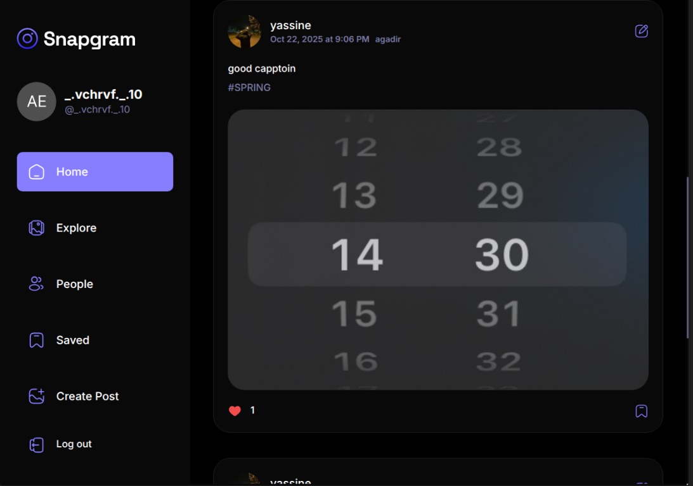

# Snapgram



Snapgram is a modern social media application for sharing photos, discovering
new content, and connecting with other users. It provides an intuitive,
responsive experience for creating and managing posts, interacting with the
community, and customizing user profiles.

## Features

- Create, edit, and delete image posts
- Explore posts and discover other users
- Like and save posts for later
- View post details and related content
- Follow user activity through profiles
- Update profile information and profile images
- Responsive layouts for desktop and mobile screens
- Authentication and data storage powered by Appwrite

## Tech stack

- React 19
- TypeScript
- Vite
- Tailwind CSS
- React Router
- TanStack React Query
- Appwrite

## Getting started

### Prerequisites

- Node.js 18 or newer
- An Appwrite project with authentication, database, and storage configured

### Installation

1. Clone the repository:

   ```bash
   git clone https://github.com/AchrafELBANOURI/SNAPGRAM.git
   cd SNAPGRAM
   ```

2. Install dependencies:

   ```bash
   npm install
   ```

3. Create a `.env.local` file in the project root and configure the Appwrite
   values used by the application:

   ```env
   VITE_APPWRITE_URL=
   VITE_APPWRITE_PROJECT_ID=
   VITE_APPWRITE_DATABASE_ID=
   VITE_APPWRITE_STORAGE_ID=
   VITE_APPWRITE_USER_COLLECTION_ID=
   VITE_APPWRITE_POST_COLLECTION_ID=
   VITE_APPWRITE_SAVES_COLLECTION_ID=
   VITE_APPWRITE_LIKES_COLLECTION_ID=
   ```

4. Start the development server:

   ```bash
   npm run dev
   ```

The application will be available at the local URL printed by Vite.

## Available scripts

| Command | Description |
| --- | --- |
| `npm run dev` | Start the Vite development server |
| `npm run build` | Type-check and build for production |
| `npm run lint` | Run ESLint |
| `npm run preview` | Preview the production build locally |
